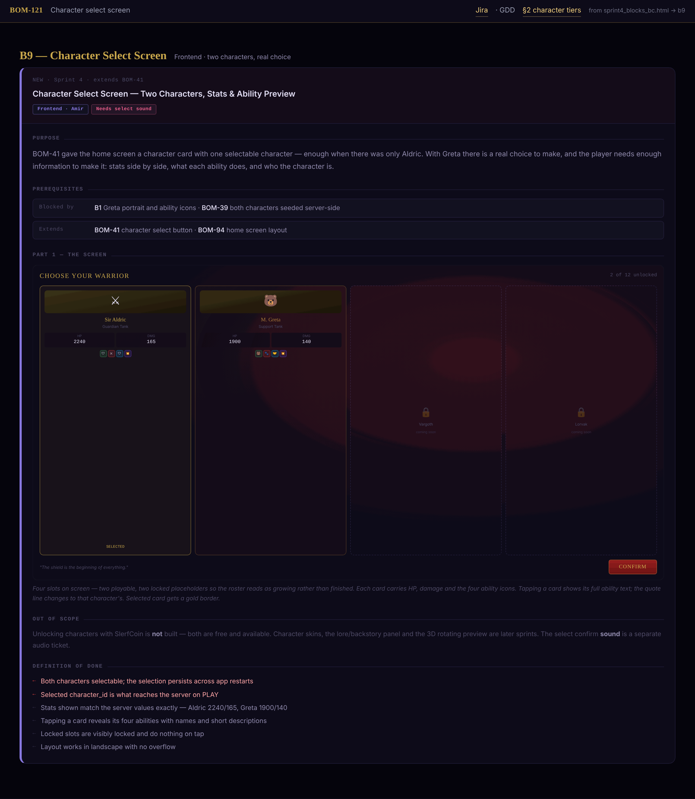

# BOM-121 — Character select screen

## Links

- **Jira:** [BOM-121](https://stiv90000.atlassian.net/browse/BOM-121)
- **Spec:** [`docs/06_Meta_Economy.md`](https://github.com/Bomslerf/BomSlerf-GDD/blob/main/docs/06_Meta_Economy.md) — §2 character tiers
- **Interactive:** [`BOM-121.html`](https://github.com/MiniManch/BOMSLERF-mockups/blob/main/issues/BOM-121/BOM-121.html) — open it raw to interact
- **Image for pasting:** `https://raw.githubusercontent.com/MiniManch/BOMSLERF-mockups/main/issues/BOM-121/BOM-121.png`

## Where this came from

Extracted from the original mockup sheets.

Source sections:
  - `sprint4_blocks_bc.html → b9`

---

*Part of [BOMSLERF-mockups](https://github.com/MiniManch/BOMSLERF-mockups). The rules are owned by [BomSlerf-GDD](https://github.com/Bomslerf/BomSlerf-GDD) — where
this mockup and the GDD disagree, **the GDD wins** and the mockup gets redrawn.*
