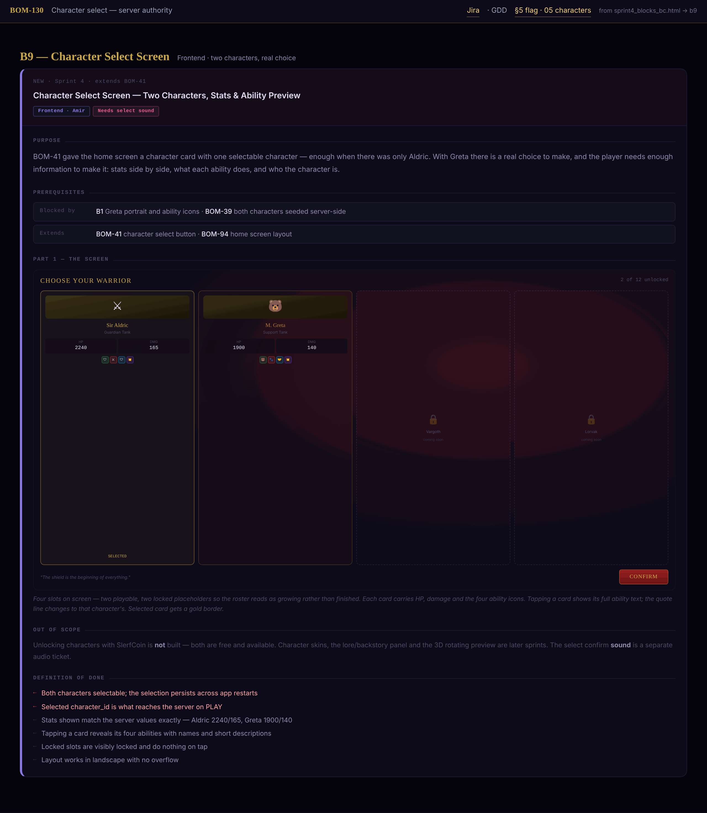

# BOM-130 — Character select — server authority

> pairs with 121

## Links

- **Jira:** [BOM-130](https://stiv90000.atlassian.net/browse/BOM-130)
- **Spec:** [`docs/02_Core_Mechanics.md`](https://github.com/Bomslerf/BomSlerf-GDD/blob/main/docs/02_Core_Mechanics.md) — §5 flag · 05 characters
- **Interactive:** [`BOM-130.html`](https://github.com/MiniManch/BOMSLERF-mockups/blob/main/issues/BOM-130/BOM-130.html) — open it raw to interact
- **Image for pasting:** `https://raw.githubusercontent.com/MiniManch/BOMSLERF-mockups/main/issues/BOM-130/BOM-130.png`

## Where this came from

Extracted from the original mockup sheets.

Source sections:
  - `sprint4_blocks_bc.html → b9`

---

*Part of [BOMSLERF-mockups](https://github.com/MiniManch/BOMSLERF-mockups). The rules are owned by [BomSlerf-GDD](https://github.com/Bomslerf/BomSlerf-GDD) — where
this mockup and the GDD disagree, **the GDD wins** and the mockup gets redrawn.*
