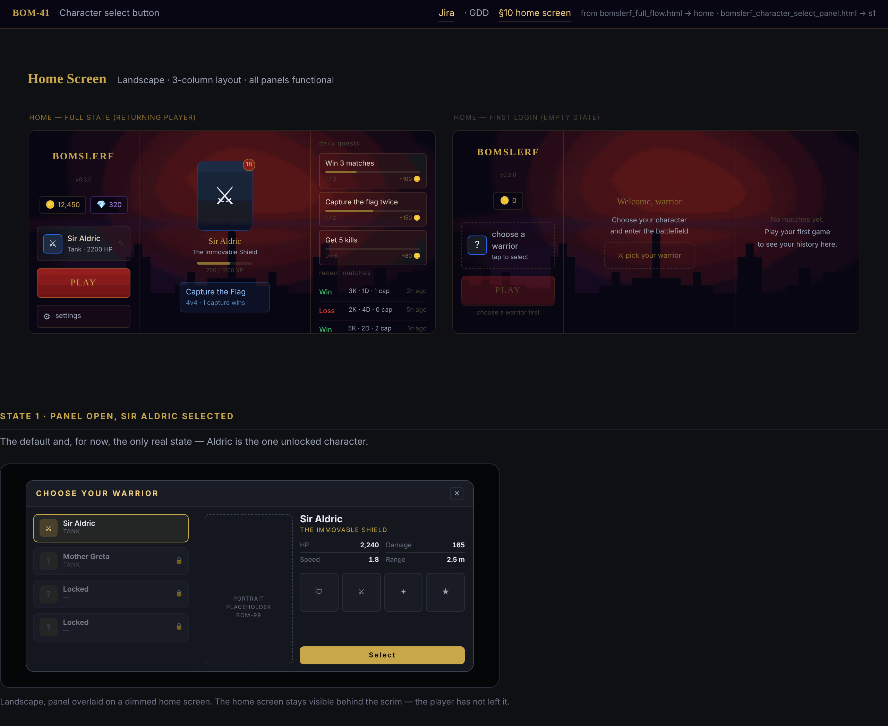

# BOM-41 — Character select button

> Sprint 3 · QA — button only, panel is 121

## Links

- **Jira:** [BOM-41](https://stiv90000.atlassian.net/browse/BOM-41)
- **Spec:** [`docs/06_Meta_Economy.md`](https://github.com/Bomslerf/BomSlerf-GDD/blob/main/docs/06_Meta_Economy.md) — §10 home screen
- **Interactive:** [`BOM-41.html`](https://github.com/MiniManch/BOMSLERF-mockups/blob/main/issues/BOM-41/BOM-41.html) — open it raw to interact
- **Image for pasting:** `https://raw.githubusercontent.com/MiniManch/BOMSLERF-mockups/main/issues/BOM-41/BOM-41.png`

## Where this came from

Extracted from the original mockup sheets.

Source sections:
  - `bomslerf_full_flow.html → home`
  - `bomslerf_character_select_panel.html → s1`

---

*Part of [BOMSLERF-mockups](https://github.com/MiniManch/BOMSLERF-mockups). The rules are owned by [BomSlerf-GDD](https://github.com/Bomslerf/BomSlerf-GDD) — where
this mockup and the GDD disagree, **the GDD wins** and the mockup gets redrawn.*
