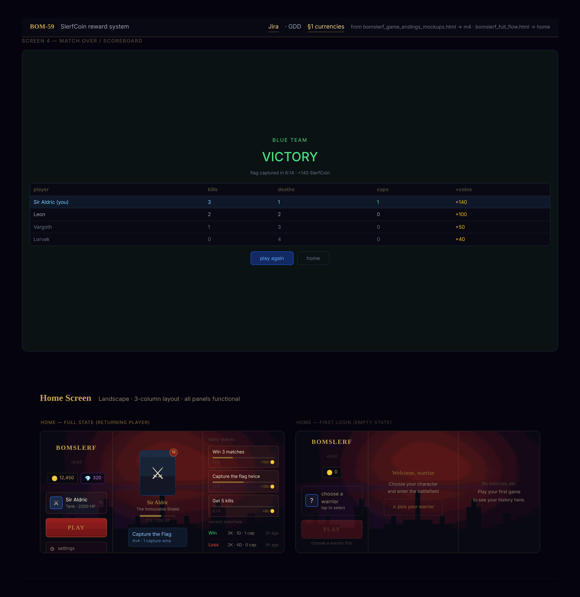

# BOM-59 — SlerfCoin reward system

> award column + home balance

## Links

- **Jira:** [BOM-59](https://stiv90000.atlassian.net/browse/BOM-59)
- **Spec:** [`docs/06_Meta_Economy.md`](https://github.com/Bomslerf/BomSlerf-GDD/blob/main/docs/06_Meta_Economy.md) — §1 currencies
- **Interactive:** [`BOM-59.html`](https://github.com/MiniManch/BOMSLERF-mockups/blob/main/issues/BOM-59/BOM-59.html) — open it raw to interact
- **Image for pasting:** `https://raw.githubusercontent.com/MiniManch/BOMSLERF-mockups/main/issues/BOM-59/BOM-59.png`

## Where this came from

Extracted from the original mockup sheets.

Source sections:
  - `bomslerf_game_endings_mockups.html → m4`
  - `bomslerf_full_flow.html → home`

---

*Part of [BOMSLERF-mockups](https://github.com/MiniManch/BOMSLERF-mockups). The rules are owned by [BomSlerf-GDD](https://github.com/Bomslerf/BomSlerf-GDD) — where
this mockup and the GDD disagree, **the GDD wins** and the mockup gets redrawn.*
