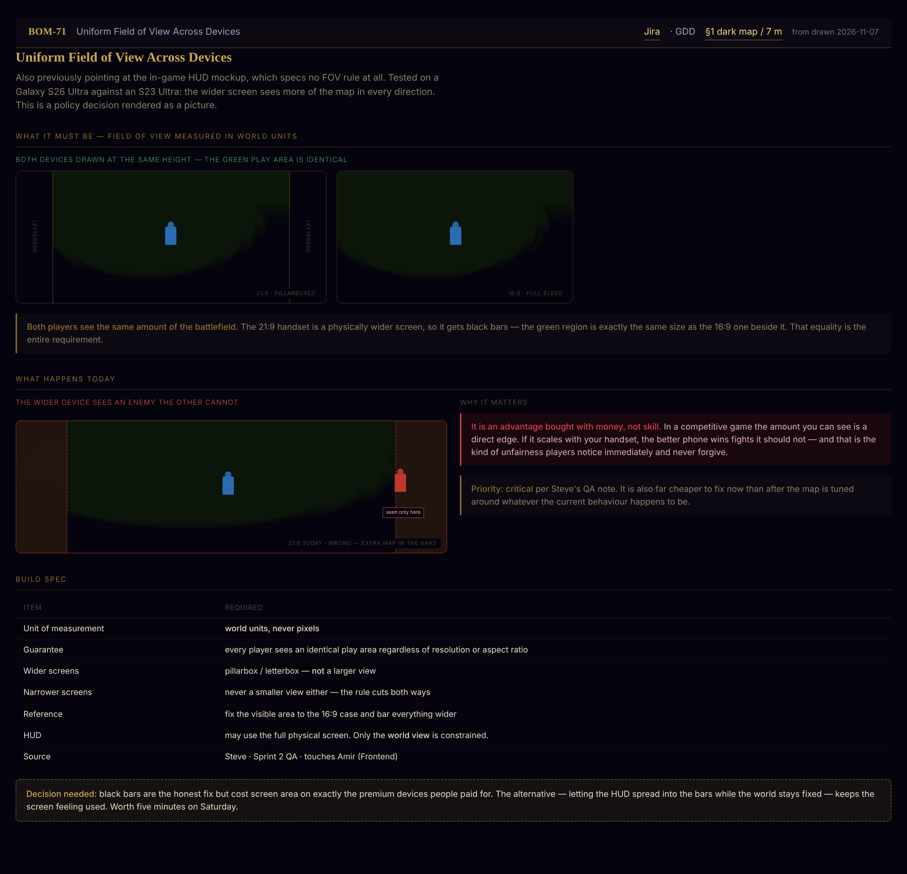

# BOM-71 — Uniform Field of View Across Devices

> NEW · drawn 2026-11-07 — replaces the wrong HUD mapping

## Links

- **Jira:** [BOM-71](https://stiv90000.atlassian.net/browse/BOM-71)
- **Spec:** [`docs/04_Vision_FOV.md`](https://github.com/Bomslerf/BomSlerf-GDD/blob/main/docs/04_Vision_FOV.md) — §1 dark map / 7 m
- **Interactive:** [`BOM-71.html`](https://github.com/MiniManch/BOMSLERF-mockups/blob/main/issues/BOM-71/BOM-71.html) — open it raw to interact
- **Image for pasting:** `https://raw.githubusercontent.com/MiniManch/BOMSLERF-mockups/main/issues/BOM-71/BOM-71.png`

## Where this came from

Drawn 2026-11-07 — this issue had no mockup and one was created for it.

Source sections:
  - `drawn 2026-11-07`

---

*Part of [BOMSLERF-mockups](https://github.com/MiniManch/BOMSLERF-mockups). The rules are owned by [BomSlerf-GDD](https://github.com/Bomslerf/BomSlerf-GDD) — where
this mockup and the GDD disagree, **the GDD wins** and the mockup gets redrawn.*
