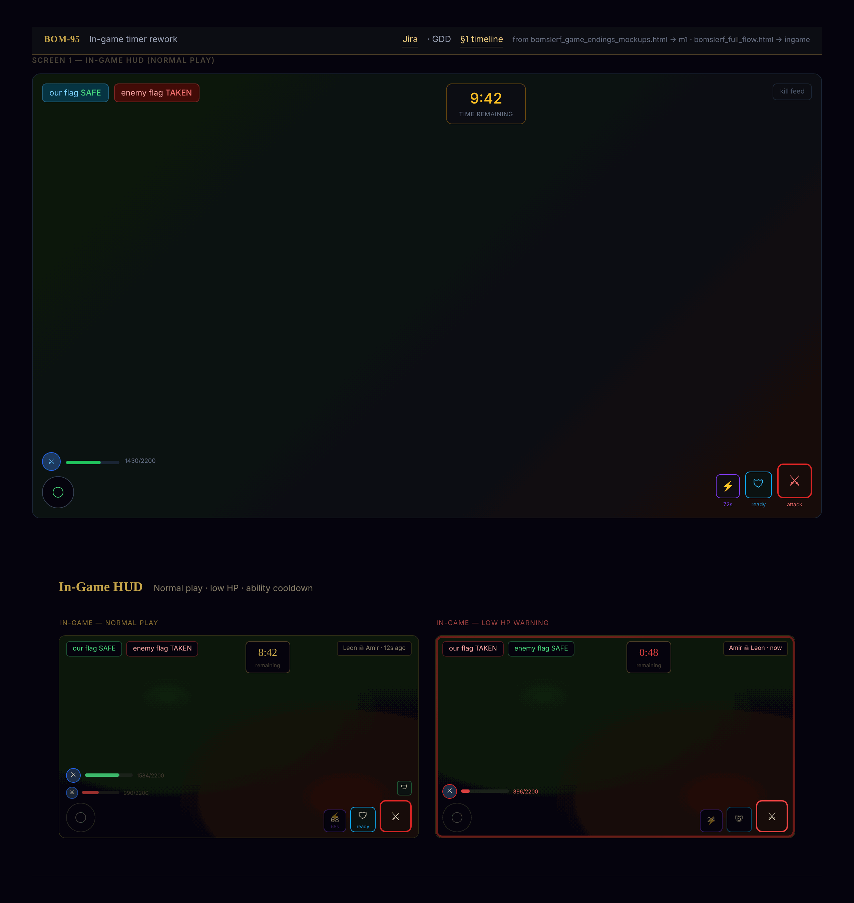

# BOM-95 — In-game timer rework

## Links

- **Jira:** [BOM-95](https://stiv90000.atlassian.net/browse/BOM-95)
- **Spec:** [`docs/02_Core_Mechanics.md`](https://github.com/Bomslerf/BomSlerf-GDD/blob/main/docs/02_Core_Mechanics.md) — §1 timeline
- **Interactive:** [`BOM-95.html`](https://github.com/MiniManch/BOMSLERF-mockups/blob/main/issues/BOM-95/BOM-95.html) — open it raw to interact
- **Image for pasting:** `https://raw.githubusercontent.com/MiniManch/BOMSLERF-mockups/main/issues/BOM-95/BOM-95.png`

## Where this came from

Extracted from the original mockup sheets.

Source sections:
  - `bomslerf_game_endings_mockups.html → m1`
  - `bomslerf_full_flow.html → ingame`

---

*Part of [BOMSLERF-mockups](https://github.com/MiniManch/BOMSLERF-mockups). The rules are owned by [BomSlerf-GDD](https://github.com/Bomslerf/BomSlerf-GDD) — where
this mockup and the GDD disagree, **the GDD wins** and the mockup gets redrawn.*
